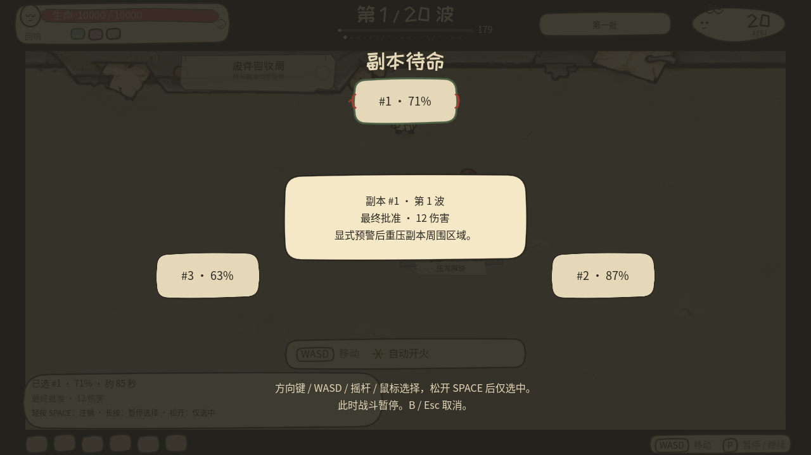

# 回响 / Take Stack


在废件回收局，昨天的你会被复印、装订，再送回战场。《回响》是一款纸偶与办公废件构成的自动射击 roguelite：你控制走位，让武器自动攻击；每场战斗都会留下可再次部署、修补、合并或主动报废的回响。

当前源码是 **0.15 开发版**：三幕 12 场远征、三个不同 Boss、六种工作单、六名角色与各自主动技、35 把武器、有限生命的支援单位、跨局回响档案、三种终局，以及完整中途保存。画面与声音继续使用 **Carbon Copy Purgatory / 废件回收局** 的粗墨、旧纸和干燥机械质感。





## 怎么玩

- **完成三幕远征。** 每幕四场，4、8、12 场分别面对监工、收集者与悖论体。监工落下压印，收集者锁向冲锋，悖论体打出十字裁切；第 12 场获胜后可继续无尽或 Boss Rush，无尽在 16、20、24……场继续出现 Boss。
- **在大工场里走位。** 2400×1200 世界由镜头跟随，战斗区域与 HUD 保持分离并响应窗口尺寸。机器既能遮挡，也能通过 `E / X` 交互：压机有真实预警与伤害，传送带改变移动，回收机花费材料恢复生命和角色能量。
- **把工作单带进下一场。** 商店固定提供 6 件货：2 把武器、2 件被动、2 张不同工作单。打捞、审计、维修、营救、招募和信用单会改变下一场的目标、敌人或环境；同时只能持有一张，替换必须明确确认并可完整撤销。
- **经营六格装备。** 18 把基础武器各有两条终极分支，共 12 把终极武器，另有 5 把支援武器。等级 0–3 的伤害倍率为 1×、1.8×、3.2×、5.5×；报价按 `1.65^等级` 计价。第 5 场起，商店可按当前武器的同等级提供配对库存；两把同 ID、同等级武器可消耗一把并付装配费，让保留槽升一级并空出一个槽位。高等级配对可能需要跨场存钱，现金改装则是不消耗供体、但刻意更贵的稳定替代。
- **部署会受伤的支援。** 纸猎犬、哨戒炮、修补站、纸树和诱饵都有生命、持续时间和实际作用；招募单还能把击败的 Boss 谈判为一名长期同伴。场上最多 12 个支援、最多一名招募同伴。纸树只提供有限护盾与能量，不制造免费现金。
- **手动拾取为主动技充能。** 亲自拾取材料会同时获得现金，并按每单位 4 点、单次最多 20 点补充角色能量；波末自动结算只给现金。能量满 100 后按 `Shift / LB` 使用角色技能，成功后进入 6 秒冷却。
- **维护过去的自己。** 回响会在战斗播放中磨损。轻按 `Space / RB` 消耗所选回响，释放由主导武器决定的技能；按住打开暂停选择轮盘。商店中可修补或用 `skill / repair / power` 三种供体特质合并；宿主保留完整路线，预览不分配 UID，也不修改原件。
- **留下跨局档案。** 结算页可保存本局最强回响；标题页可预览并开关继承。每个有回响槽的角色只保留一张，拒收件、每日挑战与仍欠债的结算不能归档。继承回响占用正常槽位，开局伤害预算按 0.75 倍规范化，耐久最多 60。

## 角色

| 角色 | 主动技（100 能量，6 秒冷却） | 解锁 |
|---|---|---|
| 折痕 / Creased | 倒回位置、回响播放和武器冷却 | 初始 |
| 拒收件 / Reject | 无回响；纸冲刺造成路径伤害并短暂格挡 | 最佳场次 4 |
| 套印件 / Misprint | 与所选回响交换位置并保留短暂锚点 | 通关 1 次 |
| 装订员 / Binder | 以所选回响为锚释放三次接力电弧 | 最佳场次 8 |
| 修补员 / Mender | 放置有限次数的修补站 | 最佳场次 3 |
| 超载员 / Overloader | 报废所选回响，按其当前耐久缩放强化爆发 | 最佳场次 7 |

主动技与回响报废是两套独立输入。角色技能失败时不会消耗能量，例如套印件没有可交换的回响、或修补员已触及支援上限。

## 工作单、债务与终局

| 工作单 | 下一场的实际变化 |
|---|---|
| 打捞 / Salvage | 三个零件必须在场内亲自交互，不能波末代收 |
| 审计 / Audit | 两台终端会产生真实危险区；累计完成两次审计优先进入释放结局 |
| 维修 / Repair | 故障压机持续制造威胁，交互后停机 |
| 营救 / Rescue | 保护目标会被敌人接触伤害，可成功也可失守 |
| 招募 / Recruit | Boss 倒地后保留 8 秒谈判窗口，自动攻击不会直接抹掉它 |
| 信用 / Credit | 立即获得 30 材料并记 40 债务；普通工作单失败不会凭空加债 |

第 12 场结算应用一次且不叠加的结果：**释放**修满现有回响并核销债务；**互助**回满生命，并修复现有招募同伴或在容量允许时补入一名；**负债**获得 24 材料但保留债务。

## 操作

| 操作 | 键位 |
|---|---|
| 移动 | WASD / 方向键 / 左摇杆 / 十字键 |
| 开火 | 自动 |
| 角色主动技 | Shift / LB |
| 世界交互 | E / X |
| 报废所选回响 | 轻按 Space / RB |
| 选择回响 | 按住 Space / RB，松开确认 |
| 暂停 / 返回 | P / Esc / Start |
| 设置 | O |
| 对局记录 | H |
| 保存并返回选角 | 暂停时 Q，或暂停菜单按钮 |
| 静音 | M |
| 调试信息 | F3 / View |

菜单和商店支持鼠标、键盘焦点、十字键与 A/B。战斗 HUD 固定在画面上下边缘；底部仅保留紧凑装备与操作信息。960×540 使用真实响应式布局：选角每页 3 人，商店、结算、档案与 HUD 都保持按钮在屏内；世界视野随可用战斗区域调整，角色像素尺寸不做全局缩小。

## 保存与 0.15 兼容性

暂停菜单的“保存并返回”、标题页“继续”、窗口关闭和语言切换使用同一份 Snapshot v2。它保存角色能量与冷却、支援单位、工作单与债务、交互物、分级报价、装配/撤销、回响合并元数据和 Boss 谈判状态；读取会先验证有界、已知类型的对象图，再替换当前会话。

0.15 对局快照是一次**干净断代**：0.14 的 `suspended_run.json` 不兼容，不提供旧局回退或迁移路径。永久 Meta 数据（角色解锁、故事线索、回响档案）和设置继续保留。写入失败会保留正在运行的对局与先前可用文件。

## 下载与源码运行

从 [GitHub Releases](https://github.com/BrickerP/reverb/releases) 下载已发布版本；当前 0.15 的公开发布地址尚未确定，源码状态不代表已有对应公开包。

- **macOS**：开发导出使用 Godot 内置 ad-hoc 本地签名，未使用 Developer ID，也未公证。
- **Windows**：开发导出未签名，可能触发 SmartScreen。
- **Linux**：给 `TakeStack.x86_64` 执行权限后运行。

从源码运行需要 **Godot 4.7.2**：

```bash
git clone https://github.com/BrickerP/reverb.git
cd reverb
make run
make run-zh
```

也可用 Godot 打开 `project.godot` 后按 F5。语言默认跟随系统，可用 `REVERB_LANG=en` 或 `REVERB_LANG=zh` 覆盖。

## 开发与验证

```bash
make test
make smoke
make perf
make frames
make export
python3 -m pip install -r tools/requirements-dev.txt
python3 -m unittest discover -s tests -p 'test_*.py'
```

这些入口来自当前 `Makefile` 与 CI。`requirements-dev.txt` 固定 NumPy 2.0.2 与 Pillow 11.3.0，只服务配乐/透明度工具和 Python CI；游戏运行不需要 Python。

原生收官探针已完成 EN 1280×720（46 张 PNG、440 项检查）与 ZH Reduced 960×540（47 张 PNG、449 项检查），失败列表为空；两套都从真实 Main/UI 输入执行功能，并对每个模拟截图做严格 Snapshot 恢复。24 次脚本经济对局证明 Boss 预警策略和构筑规则会实际影响结果，但不是人类难度或平衡结论。三平台最终导出仍在收口，本文不提前声明导出完成或最终全套测试数量。

当前仍未由真人或目标设备验证：长期平衡与主观趣味、实体手柄、Windows GUI、Steam Deck、低端硬件和跨设备 60 FPS。macOS 包为 ad-hoc 且未公证，Windows GUI 包未签名。

20 项入口到证据的状态见 [closeout-acceptance.md](docs/closeout-acceptance.md)。工程规则见 [DESIGN.md](DESIGN.md) 与 [INTERFACES.md](INTERFACES.md)；美术与战斗表现见 [art-direction.md](docs/art-direction.md) 与 [battle-direction.md](docs/battle-direction.md)；商店文案见 [STORE.md](STORE.md)。

## 许可

代码与文档采用 [MIT](LICENSE)。原创插画、音乐与音效的生产来源随仓库保留；字体和第三方素材许可见 [THIRD_PARTY.md](THIRD_PARTY.md)。
