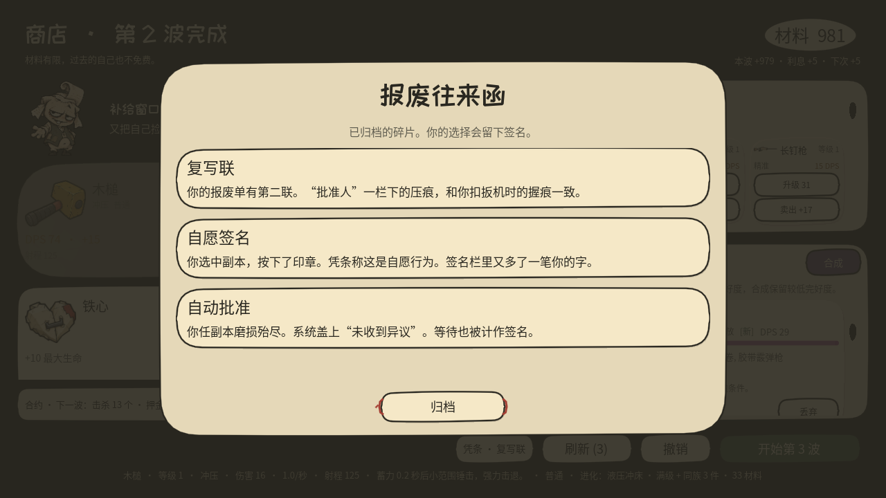

# 回响 / Take Stack

[English](README.en.md)

**昨天的你，是今天的耗材。**

你走，武器自己打。留下的那张会磨破。结局要自己签字。

先在纸上走两步：[brickerp.github.io/reverb](https://brickerp.github.io/reverb/)。三秒前的你跟在后面，然后被揉掉。下载在 [Releases](https://github.com/BrickerP/reverb/releases)。

六个人

| 角色 | 主动技 | 解锁 |
|---|---|---|
| 折痕 | 倒回位置，并倒回回响与武器冷却 | 初始 |
| 拒收件 | 没有回响。纸冲刺 | 最佳场次 4 |
| 套印件 | 和选中的回响交换位置 | 通关 1 次 |
| 装订员 | 以回响为锚，放三次接力电弧 | 最佳场次 8 |
| 修补员 | 放下次数有限的修补站 | 最佳场次 3 |
| 超载员 | 报废选中的回响，按剩余耐久打出一击 | 最佳场次 7 |

工作单、结局、操作

商店同时只有一张工作单：打捞、审计、维修、营救、招募、信用。买工单是去承担责任，不是把危险买出来。

第 12 场后自己签字：放行、共同离开，或接管回收局。债务不会自动变成坏结局。

移动 WASD。主动技 Shift。和机器说话按 E。轻点 Space 报废回响，按住则换一张。

数字和存档见 [DESIGN.md](DESIGN.md)。源码需要 Godot 4.7.2，`make run`。

代码与文档 [MIT](LICENSE)。字体见 [THIRD_PARTY.md](THIRD_PARTY.md)。
