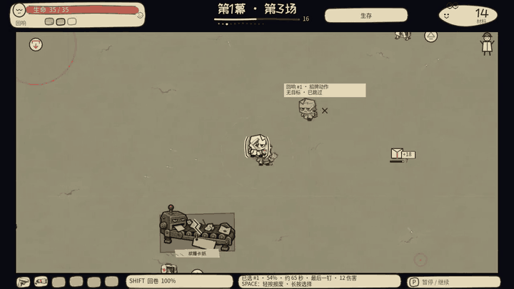

# 回响 / Take Stack

[English](README.md) · [进入废件回收局](https://brickerp.github.io/reverb/?lang=zh)

**领取可玩的副本：** [macOS 下载](https://github.com/BrickerP/reverb/releases/latest/download/TakeStack-macos.zip) · [Windows 下载](https://github.com/BrickerP/reverb/releases/latest/download/TakeStack-windows.zip) · [Linux 下载](https://github.com/BrickerP/reverb/releases/latest/download/TakeStack-linux.zip)

[](https://brickerp.github.io/reverb/?lang=zh)

**人没了，班还得上。**

《回响》是一款手绘纸偶自动射击 roguelite。你负责走位与构筑，每场战斗留下路线和装备，让过去的自己沿旧路再次作战。回响在播放中逐渐磨损；修补、合订，或提前报废，决定留给下一场的是什么。



- **给过去安排工作。** 旧路线能分担火力，也能重放机器操作。按住选择回响，轻按报废，释放由它的装备决定的最后一招。
- **把工位用起来。** 拉开关、送公文、躲过落章，把敌人引进机器的攻击范围。六名角色各有主动技，宠物、炮台和维修站也有生命与寿命。
- **签字之前，先看代价。** 35 把武器、同级装配、家族进化分支与工作单构成商店的选择。修好的设备和救下的工友，会在这次远征中跨场保留。
- **最后一页，自己签。** 三幕十二场，三个不同 Boss。离开、与工友共同离开，或者接管回收局；债务不替你选择结局。

0.18.3 商店只报生命。第 12 波十字按真实伤害报价。进化武器钉住一次致命十字。回响满了也不拦住出发。

[看完整介绍](https://brickerp.github.io/reverb/?lang=zh) · [版本说明与实机演示](https://github.com/BrickerP/reverb/releases/latest)

<details>
<summary>操作、安装与存档</summary>

- 移动：WASD／方向键／左摇杆。
- 角色主动技：Shift／LB；机器交互：E／X。
- 报废回响：轻按 Space／RB；选择回响：按住并松开确认。
- 暂停：P／Esc／Start；暂停菜单可以保存并返回。

下载对应平台 ZIP，解压后运行。macOS 包为 ad-hoc 签名、未公证，首次打开请按包内 `MAC_START_HERE.txt` 操作。Windows 包未签名，可能显示系统提示。

0.18.3 可继续 0.17、0.18、0.18.1、0.18.2 的中途存档，无需重开；更早格式的对局需重新开始。永久角色解锁、设置和已保存的回响档案保留。

</details>

<details>
<summary>从源码运行</summary>

使用 Godot **4.7.2**。以下命令取得与 0.18.3 公开版对应的源码：

```bash
git clone --branch v0.18.3 https://github.com/BrickerP/reverb.git
cd reverb
make run
```

也可以用 Godot 打开 `project.godot` 后按 F5。`make run-zh` 使用中文。

[玩法接口](https://github.com/BrickerP/reverb/blob/v0.18.3/INTERFACES.md) · [美术方向](https://github.com/BrickerP/reverb/blob/v0.18.3/docs/art-direction.md) · [验收范围](https://github.com/BrickerP/reverb/blob/v0.18.3/docs/closeout-acceptance.md)

</details>

代码与文档采用 [MIT](LICENSE)。美术及声音来源、字体许可见[美术方向](https://github.com/BrickerP/reverb/blob/v0.18.3/docs/art-direction.md)与[第三方说明](THIRD_PARTY.md)。
