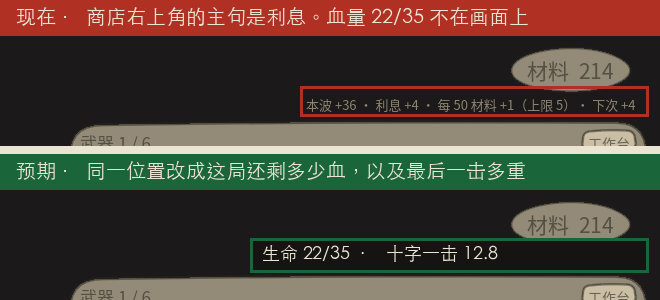
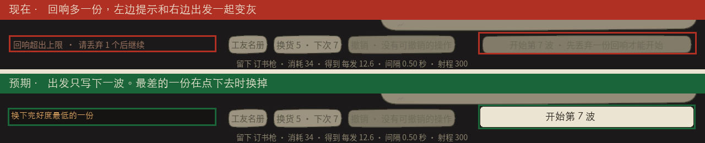
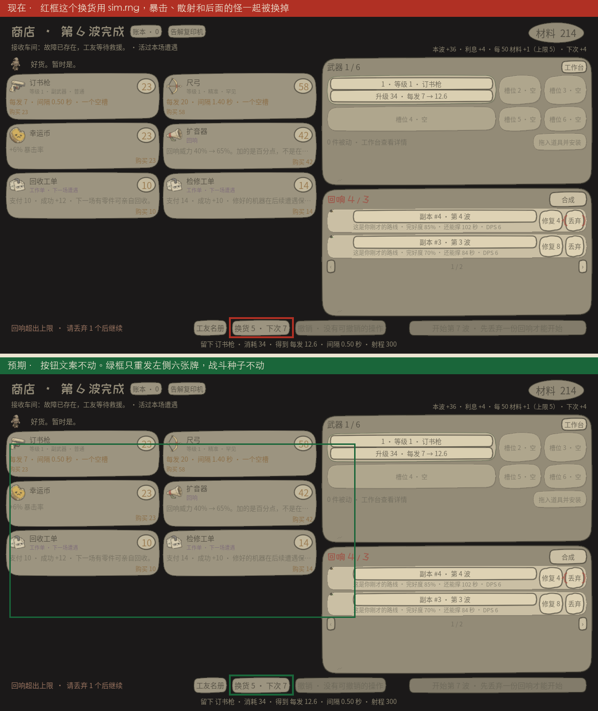
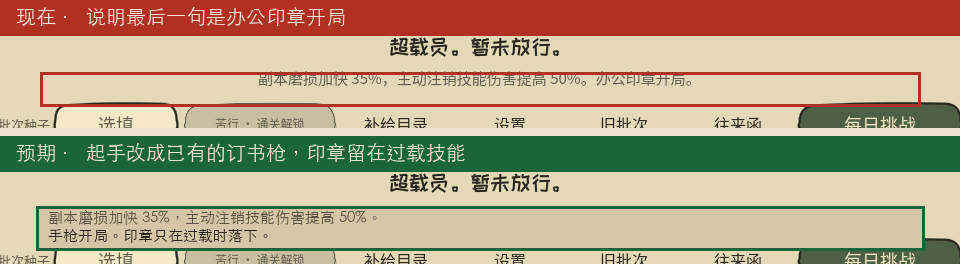

# 收敛清单

这四项已经写进当前代码。截图仍是改之前的界面，绿框是当时的预期。

四件事。不加新系统，不新做角色，不给进化再写一屏。

依据是 0.18.2 的真 `Sim`：6 个种子、六个角色、102 局。走位固定之后，能活过 Paradox 的购买只有加血。六把手枪加七八次升级，血仍会被十字打穿。利息、回响、进化没有进入这一击。

截图是当前界面。红框是现在，绿框是预期。预期是画在同一张图上的，还没有进游戏。商店这张是摆出来的局面，用来把规则露出来：折痕、第 6 波商店、材料 214、生命 22/35、回响 4 份 / 容量 3。选角是真界面。

Paradox 基础伤害 8，十字结算 `damage * 1.6`，一击 12.8。折痕生命上限是 35。

## 1. 商店主句改成血

现在右上角教人存利息。102 局里把钱留在口袋、或换成升级，都死在同一击。血量不在这个画面上。

利息计算先留着，收进悬停。主句换成这局还剩多少血，以及十字一击多重。

## 2. 回响满了不再卡住出发

多一份回响时，左边写「请丢弃」，右边出发变灰，文案是「先丢弃一份回响才能开始」。折痕老手一局要过这个门 4 到 7 次，镜像平均扔 9 份。把钱花进扩音和槽位的人死得更早。

`EchoBank.trim_to` 已经会按最弱的一份裁掉。出发时调用它。按钮只写「开始第 7 波」。被换下的那一份用左边那行说清楚。

## 3. 换货不再改战斗

换货按钮的文案不用改。要改的是它摸到的骰子。

`shop.gd` 发枪、发道具用 `sim.rng`。暴击和散射也用 `sim.rng`。换一次货，后面整场战斗换成另一条时间线。危险物已经有 `hazard_rng`，商店不能挪用它，否则换货会改危险物的位置。

商店牌面改成由种子、波次、换货次数推导。不给 `Sim` 加新字段。Snapshot v4 刚拒过多出来的列。

## 4. 超载员不用印章开局

按「我是谁就买谁的起手枪」打，超载员 0/6，第 7 到 11 波死于 grunt 和 runner。印章是近战重击，到达 180。角色真正的身份是过载那一下，不是开局贴脸。

起手改成已经存在的订书枪。印章留在过载技能里。不新做武器。

## 先不做

- 新角色、新回响词条、新武器。
- 进化教程。这 102 局里进化是 0 次，因为升级被摊在六把枪上，没有一把满级。还不能证明进化没用。在有一局「单枪点满、同家族三把」打过 Paradox 之前，不为它写界面。
- 不删利息规则，只把它从主句拿掉。
